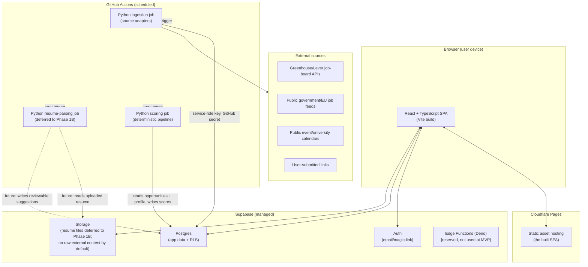

# Architecture

Status: the component list and boundaries below are **confirmed direction**; exact library/service
choices within them are cross-referenced to ADRs, each marked with its own status. This document
explains the *why*, not just the *what* — read it alongside [docs/adr/](adr/README.md).

## 1. Guiding constraints

- Single user today, must not require a rewrite to support more (see
  [ADR-008](adr/ADR-008-private-first-multi-user-later.md)).
- $0 recurring cost by default (see [ADR-009](adr/ADR-009-zero-cost-mvp-deployment.md) and
  [COST_MODEL.md](COST_MODEL.md)).
- Deterministic, explainable logic before LLM involvement (see
  [ADR-005](adr/ADR-005-explainable-ranking-before-llm-ranking.md)).
- No always-on backend server unless something genuinely requires synchronous server-side
  execution — every additional always-on process is cost, operational burden, and attack surface
  for a single-maintainer project.
- Portfolio-grade: choices should be explainable and defensible to an engineering employer, since
  this project is itself a resume artifact for the target user.

## 2. Components



### Frontend — React + TypeScript + Vite, hosted on Cloudflare Pages

A single-page app that talks **directly** to Supabase (Postgres via PostgREST/Supabase client,
Auth, Storage) using the user's own session and Postgres Row Level Security for authorization.
There is no application backend server in the MVP request/response path. Runs entirely in the
user's browser; Cloudflare Pages just serves static files (HTML/JS/CSS) over its CDN.

**Trusted/untrusted data**: the SPA renders opportunity descriptions that originated as untrusted
external HTML. All such content is sanitized server-side (during ingestion, before it ever reaches
Postgres) — see [SECURITY_AND_PRIVACY.md](SECURITY_AND_PRIVACY.md) — so the frontend can render it
as plain text/limited markup without needing to re-sanitize on every render, though defense in
depth (escaping on render) is still applied.

**Failure cases**: if Supabase is unreachable, the SPA shows cached/last-loaded data where
possible and a clear offline/error state; it never silently shows stale data as current without
indication.

### Phase 1A profile UI and client-state direction

Phase 1A introduces a profile overview plus bookmarkable Education, Experience and Research,
Projects and Links, Skills and Evidence, Languages, Preferences, and Work Eligibility pages.
Each section saves independently; the overview turns deterministic completeness checks into
concrete next actions. A section can be deliberately reviewed when empty; a per-section content
revision makes that review stale after a relevant create, update, or delete. Sections must support
empty, loading, success, validation-error, server-error, and deletion-confirmation states.

**React Router is now justified** because these are real bookmarkable pages with browser-history
behavior, not conditional panels. The first Phase 1A slice installs the current stable
`react-router` package and uses `createBrowserRouter`/`RouterProvider`; tests use
`createMemoryRouter`. **TanStack Query is not added yet**: simple typed repositories and explicit reloads
remain enough until shared cached queries across routes, repetitive mutation invalidation,
background refresh, optimistic updates, or more complex server-state coordination provides a
concrete need.

### Data and auth layer — Supabase (managed Postgres + Auth + Storage)

Supabase is not treated as a black box; it is specifically "managed Postgres with batteries." The
architecture depends on three of its parts:

- **Postgres** for all relational application data (see [DATA_MODEL.md](DATA_MODEL.md)), with
  Row Level Security policies as the authorization boundary for every user-owned table.
- **Auth** for identity (email/password or magic link at MVP). Issues the JWT the frontend uses
  for direct, RLS-scoped Postgres access.
- **Storage** for future Phase 1B resume files, in private buckets with signed URLs. Phase 1A does
  not use Storage for profile data. Raw external content (unsanitized source pages/responses) is
  **not** stored here, or anywhere, by default — see "Raw external-content retention policy" below.

Runs entirely on Supabase's managed infrastructure (their cloud, on top of AWS). The project holds
no server to patch or scale for this layer within the free tier's limits.

### Raw external-content retention policy

The durability promise this product makes is about **normalized, sanitized opportunity content**
— the fields in `opportunity_versions` (see [DATA_MODEL.md](DATA_MODEL.md)) — not about preserving
raw external HTML/JSON as it was originally fetched. Concretely:

- The default, always-on behavior is: fetch → sanitize → normalize → store the sanitized
  snapshot. The unsanitized raw response is discarded after normalization completes.
- An optional, disabled-by-default debug table (`raw_capture_debug`, see
  [DATA_MODEL.md](DATA_MODEL.md#raw-external-content-retention-debug-only-not-a-core-table)) may
  be enabled temporarily while actively developing or debugging a specific adapter, with a short,
  documented retention period (proposal: 14 days), after which rows are deleted by a scheduled
  cleanup step, not left to accumulate.
- Raw content, if ever retained under that debug path, is never rendered to the frontend, never
  sent to an LLM, and is treated as untrusted, disposable, working data — not part of the product's
  core durability guarantee. See [SECURITY_AND_PRIVACY.md](SECURITY_AND_PRIVACY.md) for the
  associated data-minimization and test-fixture rules.
- This bounds both storage cost (see [COST_MODEL.md](COST_MODEL.md)) and the amount of
  unsanitized third-party content the system ever holds at rest, which is a meaningful reduction
  in attack surface and legal/data-minimization exposure compared to keeping raw snapshots
  indefinitely "just in case."

**Failure cases**: free-tier Supabase projects pause after a period of inactivity — a scheduled
ingestion run doubles as a keep-alive, but this is documented explicitly as a real operational risk
in [COST_MODEL.md](COST_MODEL.md) and [OBSERVABILITY.md](OBSERVABILITY.md), not hidden.

### Ingestion, parsing, and scoring — Python, run by GitHub Actions on a schedule

Three related but distinct jobs, all Python, all triggered by GitHub Actions cron:

1. **Ingestion**: runs each configured source adapter, normalizes results into the common
   opportunity schema, resolves cross-source identity (auto-linking on strong evidence, flagging
   uncertain matches for review, otherwise creating a new canonical opportunity — see
   [ADR-010](adr/ADR-010-opportunity-identity-and-cross-source-deduplication.md)), diffs against
   the last known version, and writes new/updated source listings, opportunities, and version
   history to Postgres using a service-role key held in GitHub Actions secrets (never exposed to
   the browser).
2. **Resume parsing**: a future Phase 1B capability. It will extract separately reviewable
   suggestions, never overwrite confirmed profile records, and must revisit field/suggestion-level
   provenance ([ADR-014](adr/ADR-014-confirmed-profile-versus-imported-suggestions.md)).
3. **Scoring**: recomputes market-relevance and personal-competitiveness scores whenever
   opportunities or the profile change meaningfully, writing explainable, versioned score records.

Chosen as Python specifically for its data/text-processing and future ML ecosystem (resume
parsing, NLP-assisted extraction, pandas-based market analysis), independent of what language the
(currently nonexistent) synchronous backend would use if one is added later.

**Where it runs**: GitHub Actions, on standard GitHub-hosted runners. The repository is public, so
these minutes are free and unlimited (see [COST_MODEL.md](COST_MODEL.md)) — not always-on; each
job is a short-lived process that starts, does work, writes to Postgres, and exits.

**Failure cases**: a failed adapter run must not corrupt existing data — writes are additive
(new versions), and a run that errors partway logs the failure (see
[OBSERVABILITY.md](OBSERVABILITY.md)) and is safely retried on the next schedule without
duplicating data, using source-provided stable IDs or URL+content hashing for idempotency.

### Reserved, not built at MVP: a synchronous API/worker layer

Some future features (instant resume processing on upload, synchronous LLM explanations, webhook
receivers for email-based alerts) need a request/response server, not a batch job. The
architecture reserves Supabase Edge Functions (Deno, colocated with the database, generous free
tier) as the first place such logic would go, with a move to a small containerized FastAPI service
(Python, consistent with the ingestion codebase) as the fallback if Edge Functions' constraints
(execution time, language) don't fit. This is discussed, not built — see
[ADR-002](adr/ADR-002-frontend-and-backend-boundaries.md).

## 3. Repository layout (Phase 0: implemented as shown)

```
careeros/
  app/            React + TypeScript + Vite frontend (implemented, Phase 0)
  ingestion/      Python: source adapters, normalization, scoring, resume parsing
                  (placeholder only -- no code yet, see ingestion/README.md; Phase 2+)
  supabase/       config.toml, migrations/, tests/database/ (pgTAP), scripts/ (local-only
                  dev tooling) -- implemented, Phase 0
  docs/           this documentation set
  .github/workflows/   ci.yml (Phase 0); ingestion/parsing/scoring schedules are Phase 2+
```

A monorepo, not separate repositories, because the frontend, database schema, and ingestion
pipeline change together constantly at this project's size, and a single maintainer gains nothing
from cross-repo versioning overhead.

### Local development environment (Phase 0, implemented)

The local/dev-environment question in the original planning pass is now resolved and exercised,
not just decided on paper:

- **Container runtime**: Colima (Docker CLI + Colima, via Homebrew) — not Docker Desktop. Chosen
  as the lightweight open-source option; see [DEPLOYMENT_STRATEGY.md](DEPLOYMENT_STRATEGY.md) for
  the exact version and a real networking issue this surfaced (Colima's default port forwarder
  exposed the local stack to the LAN, not just localhost — fixed, documented, and worth reading
  before assuming "it just works").
- **Supabase CLI**, pinned to an exact version everywhere (locally and in CI) — never `latest`.
  Local Postgres/Auth/Storage/PostgREST run as Docker containers this CLI orchestrates.
- **Migrations are the sole source of truth** for schema, per [AGENTS.md](../AGENTS.md) — no
  manual edits in Supabase Studio (local) or a hosted dashboard (later), ever.
- **No hosted Supabase project exists yet**, and Phase 0 does not create one. No second hosted
  "dev" project either, and no Supabase Branching (unneeded complexity/cost for a $0, single-
  maintainer workflow). Exactly one hosted project is reserved for later production use only.

## 4. Alternatives considered

Each alternative below is evaluated against this project's actual constraints, not in the
abstract.

### Frontend/full-stack framework

| Option | When it would be the better choice | Why not chosen for the MVP |
|---|---|---|
| **React + Vite (chosen)** | Frontend has no need for server-side rendering; direct-to-Supabase access is sufficient; React's ecosystem/job-market familiarity is itself a portfolio asset in the German market | — |
| **Next.js full-stack** | If the product needs SEO (public opportunity board discoverable by search engines), or needs first-party API routes to avoid a separate Python service for simple endpoints | Adds a Node server/runtime to operate and reason about for no MVP benefit — the MVP is a private, single-user tool with no SEO need. **Revisit at the public-launch phase** (see [DEVELOPMENT_ROADMAP.md](DEVELOPMENT_ROADMAP.md)) if a public, crawlable opportunity board becomes a goal |
| **SvelteKit** | Smaller bundles, less boilerplate, if the team already knows Svelte | React has stronger name-recognition on German engineering-adjacent job postings, which matters because this is also a portfolio piece; smaller ecosystem for the specific needs here (resume parsing UI, forms-heavy CRUD) |

### Backend/API layer

| Option | When it would be the better choice | Why not chosen for the MVP |
|---|---|---|
| **No backend; direct Supabase access + batch Python (chosen)** | Fits a single-user tool where almost every operation is CRUD-on-your-own-data (RLS-safe) or a scheduled batch job | — |
| **FastAPI (Python) as a real API server** | Once synchronous, user-triggered server-side logic is unavoidable (instant resume parsing, LLM explanation endpoints with rate limiting, webhook receivers) | Needs an always-on host; free tiers for that (Render, Fly.io, Railway) come with sleep/cold-start behavior or limited free hours, adding operational complexity not justified yet. This is the **documented target** for when the batch-only model proves insufficient — see [ADR-002](adr/ADR-002-frontend-and-backend-boundaries.md) |
| **Node.js backend** | If the team wanted one language across the whole stack | Python was already the right choice for ingestion/parsing/scoring (see below); running two backend languages is worse than running Python everywhere non-frontend |

### Ingestion/analysis language

Python was specified as a requirement in the brief and is confirmed here: mature HTML
parsing/sanitization libraries, pandas for market-skill aggregation, and the most direct path to
future ML-assisted resume parsing or embeddings work.

### Database

See [ADR-001](adr/ADR-001-database-selection.md) for the full comparison against MongoDB and
Firebase. Summary: Postgres, because the domain is inherently relational (users, opportunities,
versions, scores, applications, tasks all reference each other) and because Postgres Row Level
Security is the specific mechanism the multi-tenant-ready design depends on.

### Search

Postgres full-text search (`tsvector`/`tsquery`) is sufficient at the MVP's realistic data volume
(dozens to low thousands of postings). A dedicated search engine (Elasticsearch, Algolia,
Meilisearch) would be justified by query volume or relevance-tuning needs this project doesn't
have, and would add a service to operate for no proven benefit. Revisit only if full-text search
demonstrably fails to support a needed query pattern.

### Vector search / embeddings

Deferred. If skill/requirement matching later benefits from semantic similarity beyond
keyword/rule matching, `pgvector` (a Postgres extension, available on Supabase) is the first step
— it keeps embeddings in the same database and transaction boundary as everything else. A
standalone vector database (Pinecone, Weaviate, Qdrant) is not justified at this data scale and
would be a second system to keep in sync with Postgres for no clear win.

### Hosting/deployment target

| Option | When it would be the better choice | Why not chosen for the MVP |
|---|---|---|
| **Cloudflare Pages (chosen) for the frontend; Supabase managed for data/auth/storage; GitHub Actions for scheduled compute** | Fits a $0, single-user, low-traffic tool with no always-on compute need | — |
| **AWS / Azure / GCP** | Needed once the project needs fine-grained IAM, VPC-level network control, managed queues at scale, or the student specifically wants cloud-provider experience with real infrastructure spend controls | Overkill for current scale; meaningfully higher operational and cost-management burden for a single maintainer. Worth revisiting deliberately at the public-launch phase, and separately, as a *learning* exercise if desired — but not required by the product |
| **Self-hosted** (home server, student cloud credits via GitHub Student Developer Pack) | If GitHub Actions free minutes or Supabase free-tier limits are actually hit | A real $0-adjacent option given the user's student status; documented as a fallback in [COST_MODEL.md](COST_MODEL.md) rather than the default, to avoid taking on server maintenance before it's needed |
| **Long-running background worker** (always-on process, not scheduled batch) | If ingestion needs near-real-time polling (many sources checked every few minutes) | Not needed at MVP ingestion frequency (daily/few-times-daily is enough for job postings and events); scheduled GitHub Actions jobs are simpler to reason about and free |
| **Dedicated serverless functions (Vercel/Cloudflare Workers) beyond Supabase Edge Functions** | If synchronous compute needs to live outside Supabase's own edge runtime for latency, language, or ecosystem reasons | Supabase Edge Functions are colocated with the database (fewer network hops, one fewer provider to manage) and are the first thing evaluated when synchronous compute becomes necessary |

## 5. Where each component runs (summary)

| Component | Runs on | Trust boundary |
|---|---|---|
| React SPA | User's browser | Untrusted execution environment; never holds secrets beyond the user's own short-lived session token |
| Cloudflare Pages | Cloudflare's CDN | Serves static assets only; no application logic or secrets |
| Supabase Auth/Postgres/Storage | Supabase-managed cloud (AWS-backed) | Authoritative data store; RLS is the authorization boundary |
| Python ingestion/parsing/scoring | GitHub Actions runners (ephemeral, per-run VMs) | Holds the Postgres service-role key as a GitHub secret; never exposed to the browser or logs |
| External sources | Third-party infrastructure | Fully untrusted; every response is treated as untrusted data, sanitized before storage |

## 6. Scalability limits of this design

This design comfortably handles one user and a realistic ingestion volume (low thousands of
opportunity records, daily-to-hourly ingestion cadence). Known ceilings, documented honestly rather
than solved preemptively:

- **GitHub Actions minutes** are free and unlimited on standard runners for this public
  repository; the practical ceiling is runner concurrency and job duration, not a minute quota —
  not a problem at daily/few-times-daily cadence, would become a design question at near-real-time
  polling of many sources.
- **Supabase free-tier project pausing on inactivity** requires a keep-alive strategy (the
  scheduled jobs themselves largely cover this, but this is a real fragility, not a solved
  problem — see [COST_MODEL.md](COST_MODEL.md)).
- **No synchronous backend** means any feature requiring instant server-side response (real-time
  chat-style LLM interaction, instant resume feedback) is out of scope until the Edge
  Function/FastAPI layer is added.
- **Single Postgres instance** is fine well past MVP scale; if this ever supports many public
  users with heavy concurrent write load, connection pooling (Supabase provides PgBouncer) and,
  much later, read replicas would be the next steps — not a redesign.

## 7. GitHub Actions reliability characteristics (read before relying on cadence)

The cadences in [DATA_FLOW.md](DATA_FLOW.md#5-data-freshness-expectations-proposal) are targets,
not guarantees. This is not a caveat to skim past — it shapes how every scheduled job and every
UI status indicator must be built:

- **Scheduled (`cron`) triggers are best-effort and can start late.** GitHub's own documentation
  states that scheduled workflows may be delayed during periods of high load, most commonly at the
  top of the hour (`:00`) when many repositories' cron jobs fire at once, and can occasionally be
  skipped during platform incidents. A job "running every 15 minutes" should be read as "running
  approximately every 15 minutes, best-effort," not as a real-time guarantee.
- **Cron expressions should avoid `:00`.** Every scheduled workflow in this project should use an
  offset minute (e.g., `7,22,37,52 * * * *` rather than `0,15,30,45 * * * *`) specifically to avoid
  the top-of-hour congestion GitHub documents.
- **Every scheduled job must be idempotent and safely retryable**, because "it didn't run on
  schedule, so I'll just run it again a bit late or trigger it manually" must always be a safe
  action, never a risk of duplicating data — see the idempotency rules in
  [DATA_FLOW.md](DATA_FLOW.md).
- **Resume parsing (and any similar per-item batch processing) is eventually consistent, not
  instant.** The UI must represent this honestly with explicit `pending` / `processing` /
  `completed` / `failed` states (see [DATA_MODEL.md](DATA_MODEL.md#resume-domain)) rather than a
  single "done" flag that implies more immediacy than the system can deliver.
- **Jobs must atomically claim the work they process**, so that two overlapping runs (e.g., a
  scheduled run and a manually-triggered one firing close together) cannot both pick up and
  process the same pending item. The pattern is a conditional `UPDATE ... WHERE status = 'pending'
  RETURNING *` — the database's own atomicity is what prevents the race, not application-level
  locking. This is a Phase 1B requirement; its eventual resume-processing design must document a
  worked sequence before implementation.
- **A job that dies after claiming an item needs a lease/timeout recovery path.** If a runner is
  killed mid-processing, the claimed item must not stay stuck in `processing` forever — a
  subsequent run's claim query must also match items whose `processing` status has an expired
  lease (a `claimed_at` older than a defined timeout) and reclaim them.
- **`workflow_dispatch` is a developer control, not a user-facing button.** GitHub Actions supports
  manually triggering a workflow via `workflow_dispatch`, but this requires repository write
  access and a GitHub-authenticated call — it is not something the frontend can safely expose as a
  "reprocess now" button to the browser, because doing so would require embedding a GitHub token
  with repository/workflow permissions in browser-reachable code, which is a secret-exposure risk
  this project will not accept. If a user-triggered "process this now" action is ever wanted, it
  belongs to the synchronous Edge Function/worker layer (below), not to GitHub Actions.
- **A synchronous layer is the correct fix once waiting is a demonstrated problem, not before.**
  If eventual consistency on this cadence turns out to be a real, observed pain point for the
  user (not a hypothetical one), the next step is the Supabase Edge Function (or containerized
  API/worker) layer already reserved in [ADR-002](adr/ADR-002-frontend-and-backend-boundaries.md)
  — this document does not introduce that layer now, and no code should anticipate it before it's
  actually decided.
- **GitHub Actions usage should still be watched, even though it's free here.** This repository is
  public, so standard-runner minutes carry no monthly quota (unlike a private repository on the
  free plan) — but larger/specialized runners and some storage or advanced Actions features can
  still be billable, so a specific cadence choice should be checked against GitHub's own
  billing/usage settings before being relied on, not assumed from a number in this document. See
  [COST_MODEL.md](COST_MODEL.md) and [OPEN_QUESTIONS.md](OPEN_QUESTIONS.md).
