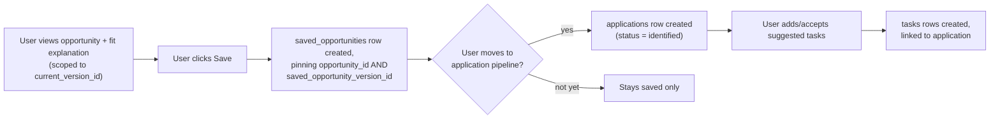

# Data Flow

Status: **proposal**, consistent with [ARCHITECTURE.md](ARCHITECTURE.md) and
[DATA_MODEL.md](DATA_MODEL.md).

## 0. A standing caveat: GitHub Actions is a scheduler, not a reliable interactive system

Every flow below runs on GitHub Actions cron. Cron triggers are **best-effort and can start
late** — GitHub documents that scheduled workflows may be delayed, especially at the top of the
hour when load is highest, and can occasionally be dropped entirely during platform incidents.
Every flow in this document is therefore designed to be **idempotent, safely retryable, and
tolerant of a job simply not running exactly on schedule** — nothing here assumes cron fires at a
precise time, and no user-facing feature should imply otherwise. See
[ARCHITECTURE.md](ARCHITECTURE.md#7-github-actions-reliability-characteristics-read-before-relying-on-cadence)
for the full set of reliability characteristics this constrains.

## 1. Opportunity ingestion, deduplication, and scoring flow

```mermaid
sequenceDiagram
    participant Cron as GitHub Actions (cron, best-effort timing)
    participant Adapter as Source adapter (Python)
    participant Norm as Normalizer
    participant Dedup as Identity/dedup step
    participant DB as Postgres (Supabase)
    participant Score as Scoring engine (Python)
    participant SPA as React SPA

    Cron->>Adapter: run scheduled ingestion job (may start later than scheduled)
    Adapter->>Adapter: fetch from source (compliant API/feed)
    Adapter->>Norm: raw source record
    Norm->>Norm: map to common opportunity schema,\nsanitize content, classify category/subtype
    Norm->>DB: upsert source_listings row\n(keyed on source_id + external_id)
    Norm->>Dedup: does this source_listing already map\nto a canonical opportunity?
    alt listing already linked
        Dedup->>DB: has captured content changed vs. current version?
        alt changed
            Dedup->>DB: insert new opportunity_version\n(full field set, tied to this source_listing_id)
        else unchanged
            Dedup->>DB: update source_listings.last_seen_at only
        end
    else new, unlinked listing
        Dedup->>DB: check for strong deterministic match\n(exact application URL, or shared upstream ID)\nagainst existing opportunities
        alt strong match found
            Dedup->>DB: link source_listing.opportunity_id = matched opportunity;\ninsert opportunity_version tied to this listing
        else weak/uncertain match found
            Dedup->>DB: create new opportunity (own identity);\ninsert potential_duplicate_links row (status = pending_review)
        else no match signal at all
            Dedup->>DB: create new opportunity + version 1,\nsource_listing.opportunity_id = new id
        end
    end
    Note over DB: a source_listing no longer found in a fresh fetch\nis marked status = removed on the listing;\nthe canonical opportunity is marked removed only when\nevery linked listing is removed
    Cron->>Score: run scoring job (after ingestion; also best-effort timing)
    Score->>DB: read opportunities whose current_version_id changed\nsince last scoring run, + current user profile
    Score->>Score: compute market-relevance score (Ranking 1)
    Score->>Score: compute personal-competitiveness score (Ranking 2)
    Score->>DB: insert new score rows keyed to the specific\nopportunity_version_id just computed (never overwritten)
    SPA->>DB: query opportunities + current-version scores (RLS-scoped)
    DB-->>SPA: ranked, explainable results
```

**Trust boundary**: everything left of "Normalizer" is untrusted external content. Sanitization
(stripping scripts/active content, normalizing encoding, rejecting unreasonable payload sizes)
happens inside the normalizer, before anything reaches Postgres. Nothing from a source is ever
passed to an LLM as an instruction — only ever as data to summarize/score, and only after
grounded, deterministic processing exists to check it against (see
[ADR-005](adr/ADR-005-explainable-ranking-before-llm-ranking.md)).

**Idempotency and atomicity**: `source_listings` upserts key on `(source_id, external_id)`, so
re-running a failed or partially-completed job is safe — it will not create duplicate listings,
duplicate opportunities, or duplicate versions for unchanged content. Every write in this flow is
additive (new listing, new opportunity, new version, new score row) or a narrow, idempotent field
update (`last_seen_at`, `last_checked_at`) — nothing here mutates historical content in place.

**Deduplication is conservative by design**: automatic linking only happens on strong,
deterministic evidence (an exact shared identifier or application URL). Anything weaker becomes a
`potential_duplicate_links` row awaiting review rather than a silent merge — see
[ADR-010](adr/ADR-010-opportunity-identity-and-cross-source-deduplication.md) for the full rule
set, failure modes, and why an uncertain merge is treated as worse than a temporary duplicate.

## 2. Resume upload and profile extraction flow

```mermaid
sequenceDiagram
    participant User
    participant SPA as React SPA
    participant Storage as Supabase Storage
    participant DB as Postgres
    participant Parse as Resume parsing job (Python, scheduled, best-effort timing)

    User->>SPA: upload resume file (PDF/DOCX)
    SPA->>Storage: upload to private bucket (user-scoped path)
    SPA->>DB: create resume record (status = pending)
    Note over SPA: UI shows "Pending" immediately;\nthis is eventually consistent, not instant
    Note over Parse: runs on a short interval (e.g. every 10-15 min),\nbut a run can start late or be skipped —\nsee ARCHITECTURE.md §7
    Parse->>DB: ATOMIC CLAIM: UPDATE resumes SET status='processing',\nclaimed_at=now(), claimed_by_run_id=<this run>\nWHERE status='pending' RETURNING *
    Note over DB: the WHERE status='pending' clause is what makes the\nclaim atomic — if two overlapping runs race,\nonly one UPDATE matches and returns a row
    Parse->>Storage: fetch file (service-role, signed access)
    Parse->>Parse: extract text, structure into\nskills/education/experience/languages draft
    alt success
        Parse->>DB: write draft profile fields, resume status = completed
    else parser error
        Parse->>DB: resume status = failed, error recorded
    else job dies mid-processing (crash, runner killed)
        Note over DB: resume stays status='processing' with a stale claimed_at
        Note over Parse: a later run's claim query also matches rows where\nstatus='processing' AND claimed_at < now() - lease_timeout,\ntreating them as abandoned and reclaiming them
    end
    User->>SPA: open profile review screen
    SPA->>DB: read resume status + draft profile fields
    Note over SPA: UI renders one of pending / processing / completed / failed —\nnever implies a result exists before status = completed
    User->>SPA: accept/correct each field
    SPA->>DB: write confirmed profile fields (user-authored, RLS-scoped)
```

**Why not synchronous**: making this instant requires a server that responds to the upload
request itself (Edge Function or API), which the MVP defers — see
[ADR-002](adr/ADR-002-frontend-and-backend-boundaries.md). The UI must clearly show which of
`pending` / `processing` / `completed` / `failed` a resume is in, and must not fake immediacy.
**A synchronous Edge Function or containerized worker is the correct next step once waiting
becomes a demonstrated user problem** — not introduced now (see
[ARCHITECTURE.md](ARCHITECTURE.md#7-github-actions-reliability-characteristics-read-before-relying-on-cadence)).

**Trust boundary**: resume content is the user's own private data, not external/untrusted content
— but the *file itself* is untrusted input (must be validated as an actual PDF/DOCX, size-limited,
and parsed with a library resistant to malformed-file exploits) before parsing.

**Lease/timeout recovery**: any job that atomically claims a unit of work (this flow, and the
ingestion flow's per-listing processing) must define a lease timeout after which a `processing` row
with a stale `claimed_at` is treated as abandoned and eligible for reclaiming by a subsequent run.
Without this, a single crashed run could leave work permanently stuck in `processing`.

## 3. Saving an opportunity and generating tasks



Because `saved_opportunity_version_id` is pinned at save time, and because
`opportunity_versions` is immutable, what the user reviewed is permanently reconstructable exactly
as they saw it — including which `source_listing_id` (and therefore which source) it came from —
even if the canonical opportunity later gains new versions, gets merged with another duplicate, or
its current-version pointer moves on.

## 4. Market intelligence aggregation

A scheduled (weekly, proposal) Python job reads recent opportunity versions and their structured
required/preferred qualifications, tallies skill/tool/tooling mentions per engineering-area
category, and writes a compact aggregate snapshot to Postgres (not recomputed on every page load).
**Aggregation counts distinct canonical `opportunity_id`s, excluding any with `status =
merged_duplicate`** — never `source_listings` or `opportunity_versions` rows directly — so a
posting observed through two sources is not double-counted once a duplicate link is confirmed.
Listings still sitting in `potential_duplicate_links` with `status = pending_review` are counted
as distinct until a human confirms the merge; this is a deliberate, documented
best-effort limitation (see [ADR-010](adr/ADR-010-opportunity-identity-and-cross-source-deduplication.md))
rather than a silent inaccuracy. The frontend reads the latest snapshot directly, keeping the
expensive aggregation off the request path entirely.

## 5. Data freshness expectations (proposal)

| Data | Update cadence | Rationale |
|---|---|---|
| Opportunity ingestion | Daily, or a few times daily per source | Balances freshness against GitHub Actions free-minute budget and source politeness |
| Resume parsing | Every 10-15 minutes, eventually consistent | Fast enough to feel responsive without needing a live server — but never guaranteed to hit that interval exactly, per §0 |
| Scoring recompute | After every ingestion run that changes a `current_version_id`, and after any profile edit | Scores must never silently go stale relative to the profile or version they claim to explain |
| Market intelligence snapshot | Weekly | Aggregate trends don't meaningfully shift faster than this at MVP data volume |

These cadences are targets the schedule aims for, not commitments the system can guarantee — see
§0 and [OBSERVABILITY.md](OBSERVABILITY.md) for how staleness itself is monitored and surfaced to
the user rather than silently assumed.
