# Data Model

Status: **proposal**. This is a logical model to guide implementation, not final SQL migrations —
column types and constraints will be refined when migrations are actually written. Every
user-owned table carries a direct `user_id` ownership column. `profiles.user_id` directly
references `auth.users(id)`; child user-owned tables generally reference `profiles(user_id)`
through their direct `user_id`. RLS compares that direct ownership column with
`(select auth.uid())`; association tables additionally use ownership-safe composite foreign keys
where needed. This is what makes the schema multi-tenant-ready from day one per
[ADR-008](adr/ADR-008-private-first-multi-user-later.md). Shared/global tables (opportunities,
source listings, sources, market intelligence) are readable by any authenticated user and writable
only by the service role used by ingestion jobs. The exact permission for every table and storage
bucket — including the anonymous-access answer — is enumerated exhaustively in
[RLS_POLICY_MATRIX.md](RLS_POLICY_MATRIX.md); this document should not be treated as the
authoritative permission reference on its own.

## Revision note (Phase 1A architecture pass)

This revision corrects two gaps identified in review:

1. `opportunity_versions` previously omitted several mutable fields (location, remote status,
   deadline, source URL, category/subtype, career- and development-specific structured fields,
   sanitized display content, source metadata, parser/normalizer version), leaving them only on
   the stable `opportunities` row — which meant they could change silently without becoming part
   of history. They are now part of the version, not the stable row. See
   [ADR-006](adr/ADR-006-posting-version-history.md).
2. The model tied one opportunity directly to one source, which cannot represent the same
   real-world posting appearing through multiple sources without creating duplicates and
   double-counting market statistics. A `source_listings` layer and a conservative
   deduplication design now sit between raw source data and the canonical `opportunities` table.
   See [ADR-010](adr/ADR-010-opportunity-identity-and-cross-source-deduplication.md).
3. Phase 1 is split into **Phase 1A manual structured profile** and **Phase 1B resume intake and
   extraction drafts** ([ADR-011](adr/ADR-011-manual-profile-before-resume-extraction.md)). The
   profile model below is a Phase 1A proposal only: it does not create migrations or resume/
   suggestion structures. `profiles.profile_complete` has no authoritative role; completeness is
   derived from [PROFILE_COMPLETENESS_SPEC.md](PROFILE_COMPLETENESS_SPEC.md).

## Revision note (Phase 2A.0 architecture pass)

Manually entered opportunities are **not** part of the shared opportunity-identity domain below.
[ADR-018](adr/ADR-018-private-manual-opportunities.md) adds `private_opportunities` (see the User
activity domain table) as a structurally separate, user-owned table — private by default, ordinary
mutable CRUD rather than versioned, and outside [ADR-010](adr/ADR-010-opportunity-identity-and-cross-source-deduplication.md)'s
deduplication scope. This is a documentation-and-decision update only; no migration exists yet
(that is Phase 2A.1). [ADR-016](adr/ADR-016-typescript-ingestion-runtime.md) and
[ADR-017](adr/ADR-017-local-first-ingestion-execution.md) additionally settle the ingestion runtime
language and execution model referenced throughout [ARCHITECTURE.md](ARCHITECTURE.md) and
[DATA_FLOW.md](DATA_FLOW.md); neither changes this document's schema.

## Entity-relationship overview

```mermaid
erDiagram
    USERS ||--o| PROFILES : has
    PROFILES ||--o{ EDUCATION_ENTRIES : has
    PROFILES ||--o{ PROFILE_SECTION_REVIEWS : records
    PROFILES ||--o{ PROFILE_SECTION_REVISIONS : tracks
    PROFILES ||--o{ WORK_EXPERIENCE : has
    PROFILES ||--o{ PROJECTS : has
    PROFILES ||--o{ PROFILE_LINKS : has
    PROFILES ||--o{ USER_SKILLS : has
    SKILLS_CATALOG ||--o{ SKILL_ALIASES : has
    SKILLS_CATALOG ||--o{ USER_SKILLS : claimed_as
    USER_SKILLS ||--o{ SKILL_EVIDENCE : supported_by
    PROJECTS ||--o{ PROJECT_SKILLS : uses
    PROFILES ||--o{ USER_LANGUAGES : has
    PROFILES ||--o| PREFERENCES : has
    PREFERENCES ||--o{ PREFERENCE_LOCATIONS : has
    PROFILES ||--o| WORK_ELIGIBILITY : has
    USERS ||--o{ RESUMES : uploads
    RESUMES ||--o{ RESUME_EXTRACTIONS : produces

    SOURCES ||--o{ INGESTION_RUNS : produces
    SOURCES ||--o{ SOURCE_LISTINGS : yields
    SOURCE_LISTINGS ||--o{ OPPORTUNITY_VERSIONS : captures
    SOURCE_LISTINGS }o--|| OPPORTUNITIES : maps_to
    OPPORTUNITIES ||--o{ OPPORTUNITY_VERSIONS : has
    OPPORTUNITIES ||--o{ CAREER_MARKET_SCORES : scored_by
    OPPORTUNITIES ||--o{ CAREER_FIT_SCORES : scored_by
    OPPORTUNITIES ||--o{ DEVELOPMENT_SCORES : scored_by
    OPPORTUNITIES ||--o{ POTENTIAL_DUPLICATE_LINKS : flagged_in
    OPPORTUNITIES ||--o| OPPORTUNITIES : merged_into

    USERS ||--o{ SAVED_OPPORTUNITIES : saves
    OPPORTUNITY_VERSIONS ||--o{ SAVED_OPPORTUNITIES : snapshot_of
    USERS ||--o{ APPLICATIONS : tracks
    SAVED_OPPORTUNITIES ||--o| APPLICATIONS : becomes

    USERS ||--o{ PRIVATE_OPPORTUNITIES : enters
    PRIVATE_OPPORTUNITIES ||--o| OPPORTUNITIES : promoted_to
    APPLICATIONS ||--o{ TASKS : generates
    APPLICATIONS ||--o{ INTERVIEW_PREP_NOTES : has

    OPPORTUNITIES ||--o{ MARKET_SKILL_MENTIONS : contributes_to
```

## Profile domain (Phase 1A proposal; user-owned unless marked shared)

**Implementation status**: the implemented Phase 1A slices include refined `profiles`, refined
`education_entries`, `work_experience`, and section freshness/review rows for `basic_profile`,
`education`, and `experience`. The remaining profile-domain tables below remain logical targets,
not implemented SQL. Phase 1B resume and suggestion records are expressly excluded.

### Implemented profile-core migration note

The Phase 0 `profiles.degree_program`, `profiles.degree_year`, and
`profiles.profile_complete` columns are retained temporarily as deprecated compatibility fields.
They are not authoritative and the browser does not write them. A forward migration copies a
legacy degree year only when its profile has exactly one existing education row and that target
field is null; it never chooses a primary row, infers a status, creates an institution, or maps
the ambiguous legacy degree-program text into `degree` or `field`. Existing profiles begin with
`basic_profile` and `education` revisions at zero and no reviews. New profile creation initializes
those rows transactionally.

`last_confirmed_at` is nullable for migrated profile and education rows: `NULL` means the legacy
row has not yet been manually confirmed in the current profile model. New manual creation defaults
to the current timestamp, and later manual content edits refresh it.

**Ownership rule (binding, see [AGENTS.md](../AGENTS.md))**: every user-owned table has direct
`user_id`, including association tables. The root `profiles.user_id` references `auth.users(id)`;
child user-owned rows generally reference `profiles(user_id)` through that same direct `user_id`.
User-owned child references use ownership-safe composite foreign keys — e.g. `(user_id,
project_id)` references a unique `(user_id, id)` on `projects` — or an equivalent constraint. A
UUID alone never authorizes attaching another user's row. Each manual row may include
`created_via = manual`, `created_at`, `updated_at`, and meaningful `last_confirmed_at`; this is
row context, not a Phase 1B provenance solution.

| Entity | Purpose / ownership / key | Major foreign keys and constraints | Deletion / RLS / sensitivity / browser access / later consumer |
|---|---|---|---|
| `profiles` | One profile identity per user; user-owned; `user_id` PK. | FK `auth.users(id)`; holds only profile-level facts such as preferred name and headline; no authoritative degree program, degree year, or graduation timing; no `profile_complete`. | Cascades from Auth-user deletion; own-row RLS; High; browser SELECT/INSERT/UPDATE only — never direct DELETE; Phase 1A overview, later matching/scoring. |
| `education_entries` | Education history and authoritative education facts; user-owned; `id` PK, direct `user_id`. | `(user_id)` → `profiles`; institution, degree, field, `degree_year`, expected graduation month/year, start date, and `education_status`; date/order checks. `is_primary` is optional, but partial unique `(user_id) WHERE is_primary` permits at most one primary entry. A primary normally must be current; explicit status constraint enforces that relationship. Multiple active entries remain allowed. | Cascade from profile; own-row RLS; High; browser CRUD; completeness, matching, evidence. A later forward migration copies Phase 0 `profiles.degree_program`/`degree_year` into the selected or created primary entry before removing their authoritative role. |
| `profile_section_reviews` | Deliberate review of a UI section, including intentionally empty sections; user-owned; composite PK `(user_id, section_key)`. | `(user_id)` → profiles; controlled keys: `basic_profile`, `education`, `experience`, `projects`, `skills`, `languages`, `preferences`, `work_eligibility`; `reviewed_at`, `reviewed_content_revision`, timestamps. | Cascade from profile; own-row RLS; High; browser CRUD; deterministic review state/completeness. |
| `profile_section_revisions` | Minimal deletion-safe content freshness state; user-owned metadata; composite PK `(user_id, section_key)`. | Same controlled keys; non-negative monotonic `content_revision`, `updated_at`. Created at revision zero for each section; database-maintained mutation path increments it transactionally on relevant row create/update/delete. | Cascade from profile; own-row RLS; Medium; browser SELECT only; supports review freshness without a reset-flag trigger. |
| `work_experience` | Employment, internship, research, volunteering, student-leadership, or other evidence; user-owned; `id` PK, direct `user_id`. | `(user_id)` → `profiles`; `UNIQUE (user_id, id)` reserves an ownership-safe future evidence target. Required kind, organization, role, and start year; optional month precision and bounded plain-text location/description. End periods cannot precede start periods; a current row has no end period. | Cascade from profile; own-row RLS; High; browser CRUD; experience review/completeness and future matching. Deleting a future evidence target must cascade only its evidence rows, not the user’s skill claim. |
| `projects` | User project evidence; user-owned; `id` PK, direct `user_id`. | `(user_id)` → `profiles`; title required; bounded description; optional safe URL. | Cascade from profile; own-row RLS; High; browser CRUD; completeness, evidence, matching. |
| `profile_links` | Links to portfolio/GitHub/public work; user-owned; `id` PK, direct `user_id`. | `(user_id)` → `profiles`; URL scheme/length allowlist; labeled link. | Cascade from profile; own-row RLS; Medium; browser CRUD; evidence and optional enrichment. |
| `skills_catalog` | Small canonical skill names for matching; shared; `id` PK. | Normalized canonical name unique; bounded category and controlled `is_technical` classification; no user data. | Service maintains; authenticated read only; Low; browser SELECT only; matching and market aggregation. |
| `skill_aliases` | Controlled alternate names for a canonical skill; shared; `id` PK. | `skill_id` → catalog; normalized alias unique; aliases never point to a custom label. | Cascade from catalog; authenticated read only, service write; Low; browser SELECT only; normalization/matching. |
| `user_skills` | A user's skill claim, canonical or private custom; user-owned; `id` PK, direct `user_id`. | `(user_id)` → profile; optional `skill_id` → catalog XOR bounded `custom_label`; unique normalized claim per user; scalar `self_assessment` enum is explicitly self-reported. A claim is technical when its canonical catalog entry is controlled as technical, or a private label is explicitly self-classified technical; private labels remain private. | Cascade from profile; own-row RLS; High; browser CRUD; completeness and future matching. |
| `project_skills` | Relational project technologies/skills; user-owned association; composite PK `(user_id, project_id, skill_id)`. | `(user_id, project_id)` → projects; `skill_id` → catalog; no arrays. | Cascade from project/catalog as appropriate; own-row plus composite-parent checks; High; browser CRUD; evidence and matching. |
| `skill_evidence` | Dedicated many-row association: one typed evidence item for a skill claim; user-owned; `id` PK, direct `user_id`. | `(user_id, user_skill_id)` → user skills. Nullable `project_id`, `work_experience_id`, `education_entry_id`, `profile_link_id`, and bounded `manual_note`; a check constraint requires exactly one source. Each relational target has a same-user composite FK. Adding a new evidence category is an intentional schema change for real FK integrity; note content never enters shared aggregation. | Cascade from claim/target; own-row and parent-bypass tests; High; browser CRUD; evidence-first matching. |
| `user_languages` | Language claims; user-owned; `id` PK, direct `user_id`. | `(user_id)` → profile; normalized language unique per user; scalar CEFR enum. | Cascade from profile; own-row RLS; High; browser CRUD; readiness and matching. |
| `preferences` | Optional singleton preference container; user-owned; `user_id` PK. | FK profile; scalar `remote_preference` enum; no location/target arrays. | Zero-or-one until a migration deliberately auto-creates it; cascade from profile; own-row RLS; High; browser CRUD; matching/filtering. |
| `preference_locations` | Preferred locations relation; user-owned; `id` PK, direct `user_id`. | `(user_id)` → preferences; normalized location + country/region; unique per user. | Cascade from preferences; own-row RLS; Medium; browser CRUD; matching/filtering. |
| `engineering_areas` | Controlled engineering-area reference; shared; `id` PK. | Unique normalized name. | Service-maintained; authenticated read only; Low; browser SELECT only; targeting and matching. |
| `role_types` | Controlled role-type reference; shared; `id` PK. | Unique normalized name. | Service-maintained; authenticated read only; Low; browser SELECT only; targeting and matching. |
| `user_target_engineering_areas` | User's selected areas; user-owned association; composite PK `(user_id, engineering_area_id)`. | `(user_id)` → profile; area → catalog. | Cascade from profile/catalog; own-row RLS; Medium; browser CRUD; readiness and matching. |
| `user_target_role_types` | User's selected roles; user-owned association; composite PK `(user_id, role_type_id)`. | `(user_id)` → profile; role → catalog. | Cascade from profile/catalog; own-row RLS; Medium; browser CRUD; readiness and matching. |
| `target_companies` | Optional watchlist; user-owned; `id` PK, direct `user_id`. | `(user_id)` → profile; normalized company name unique per user; bounded note only. | Cascade from profile; own-row RLS; Medium; browser CRUD; optional enrichment, future discovery. |
| `work_eligibility` | Optional singleton minimal self-reported eligibility state; user-owned, highly sensitive; `user_id` PK. | FK profile; enum `eligible`/`eligible_with_conditions`/`requires_sponsorship`/`unknown`; optional non-negative weekly limit; `last_confirmed_at` required after review. | Zero-or-one per profile; cascade from profile; own-row RLS; Very High; browser CRUD; readiness and future eligibility checks. |

Relational structures are required for skills, aliases, project technologies, evidence, targets, and
preferred locations because they support validation, aggregation, future matching, and explainable
links. Arrays would conceal ownership and parent checks. Scalar enums remain appropriate for
remote preference, skill self-assessment, and work-eligibility state.

### Review freshness

A section is deliberately reviewed only when its `profile_section_reviews` row exists. Its review
is current when `reviewed_content_revision` equals the current revision for that section and the
review time is at least as recent as the latest relevant surviving row's `updated_at`. This lets an
empty collection be reviewed. Timestamps alone are not sufficient after deletion: deleting the
newest row could otherwise make an old review appear current. The small per-section revision row
solves that case: every relevant create, update, or delete increments its revision transactionally,
and a review records the revision it observed. This is a narrowly scoped integrity mechanism, not
a fragile trigger that flips a duplicate completeness flag.

## Resume domain

**Status: Phase 1B deferred.** These records are not part of the Phase 1A model and must not be
created until the confirmed manual profile is stable. Their eventual extraction output is a
reviewable suggestion, not a write path to confirmed profile rows.

| Table | Key fields | Notes |
|---|---|---|
| `resumes` | `id`, `user_id`, `storage_path`, `uploaded_at`, `status` (`pending`\|`processing`\|`completed`\|`failed`), `claimed_at`, `claimed_by_run_id`, `is_active_version` | File itself lives in Supabase Storage, private bucket. Its Phase 1B behavior must extend the deferred flow in [DATA_FLOW.md](DATA_FLOW.md#2b-phase-1b-resume-extraction-deferred). |
| `resume_extractions` | `id`, `resume_id`, `extracted_json`, `extracted_at`, `parser_version` | Raw extraction kept separate from confirmed profile fields, so re-parsing or parser upgrades never silently overwrite user corrections |

## Opportunity identity domain (shared/global, service-role write)

This domain is split into three layers on purpose: a **source-specific record** of what one
adapter saw, a **canonical opportunity** representing the real-world posting, and **immutable
versions** carrying the actual historical content. See
[ADR-010](adr/ADR-010-opportunity-identity-and-cross-source-deduplication.md) for the full
reasoning.

| Table | Key fields | Notes |
|---|---|---|
| `sources` | `id`, `name`, `adapter_key`, `base_url`, `legal_basis_notes`, `rate_limit_config`, `enabled` | Registry of configured adapters; see [ADR-004](adr/ADR-004-source-adapter-architecture.md) |
| `source_listings` | `id`, `source_id`, `external_id`, `canonical_source_url`, `first_seen_at`, `last_seen_at`, `status` (`active`\|`removed`), `opportunity_id` (FK, nullable until linked), `link_confidence` (`exact`\|`strong_deterministic`\|`needs_review`\|`unlinked`) | One row per (source, external_id) — this is what an adapter actually observed. Never holds descriptive content itself; content lives in `opportunity_versions` |
| `opportunities` | `id`, `status` (`active`\|`removed`\|`needs_review`\|`merged_duplicate`), `first_discovered_at`, `last_checked_at`, `current_version_id`, `merged_into_opportunity_id` (nullable, set only when `status = merged_duplicate`) | The **canonical, real-world opportunity**. Holds identity, lifecycle, and timestamps only — no descriptive content. One or more `source_listings` may point to the same `opportunities` row |
| `opportunity_versions` | see full field list below | Immutable historical snapshot. Tied to the specific `source_listing_id` whose capture produced it, and to the canonical `opportunity_id` |
| `potential_duplicate_links` | `id`, `opportunity_id_a`, `opportunity_id_b`, `match_basis_jsonb`, `match_confidence`, `status` (`pending_review`\|`confirmed_duplicate`\|`rejected`), `created_at`, `reviewed_at` | Uncertain cross-source matches that were **not** auto-merged; see dedup rules below |
| `ingestion_runs` | `id`, `source_id`, `started_at`, `finished_at`, `status`, `records_found`, `records_new`, `records_updated`, `records_removed`, `error_summary` | Operational log, also drives [OBSERVABILITY.md](OBSERVABILITY.md) |

### `opportunity_versions` — complete field list

Every mutable, historically-meaningful fact about a posting lives here, never only on the stable
`opportunities` row:

| Field | Purpose |
|---|---|
| `id` | Primary key |
| `opportunity_id` | Canonical opportunity this version belongs to |
| `source_listing_id` | Which source listing's capture produced this version (provenance) |
| `version_number` | Sequential per opportunity |
| `captured_at` | When this snapshot was taken |
| `title` | |
| `organization` | Company/institution name |
| `description` | Normalized, sanitized plain-text/limited-markup body |
| `responsibilities` | Structured or free-text, source-dependent |
| `required_qualifications` | |
| `preferred_qualifications` | |
| `location` | |
| `remote_status` | `onsite` \| `hybrid` \| `remote` |
| `deadline` | Nullable — many postings don't state one |
| `application_url` | The URL to actually apply, which may differ from `source_listings.canonical_source_url` |
| `category` | `career` \| `development` — versioned because a posting's classification can be corrected between captures |
| `subtype` | e.g. `internship`, `hackathon` — versioned for the same reason |
| `career_specific_fields` | JSONB: employment type, duration, compensation notes, etc. — only populated when `category = career` |
| `development_specific_fields` | JSONB: cost, time commitment, produces-artifact flag, event dates, etc. — only populated when `category = development` |
| `sanitized_display_content` | The exact sanitized content the frontend is permitted to render (see [SECURITY_AND_PRIVACY.md](SECURITY_AND_PRIVACY.md)); kept distinct from `description` so rendering and scoring can evolve independently |
| `source_metadata` | JSONB: source-specific fields not mapped into the common schema, retained for future remapping/debugging — sanitized, never raw HTML (see §"Raw external-content retention" below) |
| `content_hash` | Used for idempotent change detection |
| `parser_version` | Which adapter/normalizer code version produced this version |
| `normalizer_version` | Same purpose, for the shared normalization step, when it differs from the adapter's own version |

`opportunities.current_version_id` always points at the version currently treated as the
"live" content for that opportunity (ordinarily the latest by `captured_at`, but see the
duplicate-resolution note in [ADR-010](adr/ADR-010-opportunity-identity-and-cross-source-deduplication.md)
for how this is chosen when multiple source listings feed one opportunity).

## Scoring domain (shared source data, but scores are computed per user where applicable)

| Table | Key fields | Notes |
|---|---|---|
| `career_market_scores` | `id`, `opportunity_version_id`, `degree_relevance_score`, `geographic_score`, `language_score`, `overall_market_score`, `scoring_version`, `computed_at` | Ranking 1 — not user-specific |
| `career_fit_scores` | `id`, `user_id`, `opportunity_version_id`, `eligibility_status`, `degree_relevance_score`, `skill_alignment_score`, `project_evidence_score`, `experience_alignment_score`, `language_alignment_score`, `location_alignment_score`, `overall_category`, `evidence_jsonb`, `scoring_version`, `computed_at` | Ranking 2 — user-specific; `evidence_jsonb` is the explainability payload (see [SCORING_AND_MATCHING_MODEL.md](SCORING_AND_MATCHING_MODEL.md)) |
| `development_scores` | `id`, `user_id`, `opportunity_version_id`, `distance_km`, `cost_score`, `eligibility_status`, `deadline_urgency_score`, `technical_relevance_score`, `reputation_score`, `resume_value_score`, `time_commitment_score`, `produces_artifact`, `overall_score`, `evidence_jsonb`, `scoring_version`, `computed_at` | User-specific; distance/cost fields nullable when source data is missing (shown as "unknown," never fabricated) |
| `market_skill_mentions` | `id`, `skill_id`, `engineering_area`, `period_start`, `period_end`, `mention_count`, `opportunity_count` | Aggregate table backing market-intelligence view; `opportunity_count` is a count of distinct **canonical** `opportunity_id`s (excluding `status = merged_duplicate` rows), not of `source_listings`, so a posting seen through two sources is never double-counted once confirmed as one opportunity |

**Every score row is keyed to `opportunity_version_id`, never to `opportunity_id` alone — this is
deliberate and non-negotiable.** A fit score describes the user's alignment against one specific,
immutable snapshot of a posting. When a new version is captured (the source changed the posting),
existing score rows are left exactly as they are — they keep describing the version they were
computed against — and a new scoring run computes a new, separate score row against the new
version. The user-visible "current fit" is simply the score row for `opportunities
.current_version_id`; older score rows remain queryable for history/audit but are not what's shown
by default. **A fit score must never silently change because the underlying posting changed** —
if it changes, it is because a new version produced a new score row, and that is visible as a
distinct, timestamped event, not a mutation of the number the user already saw.

## User activity domain (user-owned, RLS-protected)

| Table | Key fields | Notes |
|---|---|---|
| `saved_opportunities` | `id`, `user_id`, `opportunity_id`, `saved_opportunity_version_id`, `notes`, `saved_at` | Snapshot pinning: even if the opportunity gets new versions later, this remembers which version — and, transitively via that version's `source_listing_id`, which source content — the user actually saved and reacted to |
| `applications` | `id`, `user_id`, `saved_opportunity_id` (nullable FK to `saved_opportunities`, set for a shared/ingested opportunity), `private_opportunity_id` (nullable FK to `private_opportunities`, set for a manually entered one — exactly one of the two is set), `private_opportunity_snapshot_jsonb` (populated only when `private_opportunity_id` is set — see note below), `status` (`preparing`\|`applied`\|`awaiting_response`\|`interview_scheduled`\|`interview_complete`\|`offer`\|`accepted`\|`rejected`\|`withdrawn`\|`closed`), `applied_at`, `status_updated_at`, `next_action` (nullable), `next_action_due_at` (nullable), `notes`, `contact_note` (nullable), `resume_id_used` | Current status plus timestamps only — no event-sourced status-history table at MVP (see [MVP_SCOPE.md](MVP_SCOPE.md#current-product-mode-and-engineering-priority)); "saved" is a state prior to and outside this enum, held on `saved_opportunities`/`private_opportunities` |
| `tasks` | `id`, `user_id`, `application_id` (nullable), `opportunity_id` (nullable), `title`, `due_date`, `status` (`open`\|`done`), `origin` (`manual`\|`suggested`) | Deadline-derived tasks reference the opportunity directly even before an application exists |
| `interview_prep_notes` | `id`, `application_id`, `content`, `created_at` | Free-text notes tied to the application — likely questions, topics to revise, recruiter notes, post-interview reflections all fit in `content`; no structured sub-fields at MVP |
| `private_opportunities` | `id`, `user_id`, `source_url`, `title`, `organization_name`, `location_text`, `opportunity_kind`, `employment_type`, `remote_mode`, `description_text`, `posted_at`, `application_deadline`, `application_url`, `dismissed_at`, `promoted_to_opportunity_id` (nullable, trusted-write only), `created_at`, `updated_at`, `last_confirmed_at` | **New (Phase 2A, see [ADR-018](adr/ADR-018-private-manual-opportunities.md))**: manually entered opportunities, structurally and permission-wise separate from the shared identity domain above — not written through the ingestion/dedup pipeline, not versioned like `opportunity_versions` (ordinary mutable CRUD, like `work_experience`), private by default. `promoted_to_opportunity_id` is a future, trusted-only, additive link to a canonical shared opportunity if one is later discovered by an adapter; no promotion logic exists yet. Exact column types/constraints are finalized at Phase 2A.1 implementation time |

## Raw external-content retention (debug-only, not a core table)

`raw_capture_debug` (`id`, `source_listing_id`, `raw_response`, `captured_at`, `expires_at`) is an
**optional, disabled-by-default** table used only when actively developing or debugging a source
adapter. It is explicitly not part of the product's durability promise — see
[ARCHITECTURE.md](ARCHITECTURE.md#raw-external-content-retention-policy) and
[SECURITY_AND_PRIVACY.md](SECURITY_AND_PRIVACY.md) for the full policy (short retention, never
rendered, never sent to an LLM, never relied upon for reconstructing history — that job belongs
entirely to `opportunity_versions`).

## Design notes

- **Why `source_listings` is a separate layer from `opportunities`**: it lets the same real-world
  posting be observed by more than one adapter without forcing an immediate, possibly-wrong merge
  decision, and it keeps each source's own identity/URL/timestamps intact even after a merge. See
  [ADR-010](adr/ADR-010-opportunity-identity-and-cross-source-deduplication.md).
- **Why snapshots pin a specific `opportunity_version_id`** rather than always pointing at "the
  latest": a user's saved reasoning and fit explanation refer to the posting as it existed when
  they looked at it. If requirements change later, the user should see that explicitly as a diff,
  not have their prior judgment silently reinterpreted against new text.
- **Why `applications` carries its own `private_opportunity_snapshot_jsonb`** rather than reading
  `private_opportunities` live: a shared opportunity already gets this guarantee for free through
  `saved_opportunities.saved_opportunity_version_id` pointing at an immutable
  `opportunity_versions` row. `private_opportunities` has no such immutable version history — it is
  ordinary mutable CRUD, like `work_experience` — so without its own snapshot, editing a private
  entry after applying (fixing a typo, updating a copied deadline) would silently rewrite the exact
  listing content the application and interview-prep notes refer to. The snapshot is captured once,
  at `applications` creation time, from `private_opportunities`' fields as they stood at that
  moment, and is never updated afterward — this is the smallest relationship that gives both the
  shared and private paths the same "what I applied to is preserved" guarantee without introducing
  version history for `private_opportunities` itself.
- **Why `evidence_jsonb` exists on every score table**: this is the mechanism that satisfies the
  hard explainability requirement in [PRODUCT_REQUIREMENTS.md](PRODUCT_REQUIREMENTS.md) — every
  sub-score must be traceable to the specific profile fields and posting requirement lines that
  produced it, not just a number.
- **Why `scoring_version` exists**: the scoring algorithm will change over time; historical scores
  remain interpretable (and comparable to the algorithm version that produced them) instead of
  silently becoming inconsistent with newly-computed ones.
- **Why skills are a shared catalog with per-user proficiency rows** rather than free-text tags:
  this is what makes market-skill aggregation ("skills present in the market but missing from your
  profile") possible without fuzzy string matching across the whole dataset.
- **Exact permissions are not repeated here**: see [RLS_POLICY_MATRIX.md](RLS_POLICY_MATRIX.md) for
  the table-by-table, bucket-by-bucket authorization matrix this data model depends on.
