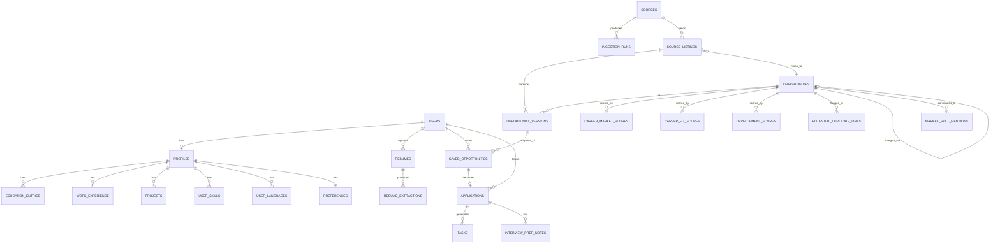

# Data Model

Status: **proposal**. This is a logical model to guide implementation, not final SQL migrations —
column types and constraints will be refined when migrations are actually written. All
user-owned tables include a `user_id` referencing `auth.users(id)` and an RLS policy restricting
access to `user_id = auth.uid()`; this is what makes the schema multi-tenant-ready from day one
per [ADR-008](adr/ADR-008-private-first-multi-user-later.md). Shared/global tables (opportunities,
source listings, sources, market intelligence) are readable by any authenticated user and writable
only by the service role used by ingestion jobs. The exact permission for every table and storage
bucket — including the anonymous-access answer — is enumerated exhaustively in
[RLS_POLICY_MATRIX.md](RLS_POLICY_MATRIX.md); this document should not be treated as the
authoritative permission reference on its own.

## Revision note (this pass)

This revision corrects two gaps identified in review:

1. `opportunity_versions` previously omitted several mutable fields (location, remote status,
   deadline, source URL, category/subtype, career- and development-specific structured fields,
   sanitized display content, source metadata, parser/normalizer version), leaving them only on
   the stable `opportunities` row — which meant they could change silently without becoming part
   of history. They are now part of the version, not the stable row. See
   [ADR-006](adr/ADR-006-posting-version-history.md).
2. The model tied one opportunity directly to one source, which cannot represent the same
   real-world posting appearing through multiple sources without creating duplicates and
   double-counting market statistics. A `source_listings` layer and a conservative
   deduplication design now sit between raw source data and the canonical `opportunities` table.
   See [ADR-010](adr/ADR-010-opportunity-identity-and-cross-source-deduplication.md).

## Entity-relationship overview

## Profile domain (user-owned, RLS-protected)

| Table | Key fields | Notes |
|---|---|---|
| `profiles` | `user_id` (PK/FK), `headline`, `work_eligibility`, `degree_program`, `degree_year`, `expected_graduation`, `profile_complete` | One row per user; `work_eligibility` captures visa/permitted-hours facts needed for eligibility checks |
| `education_entries` | `id`, `profile_id`, `institution`, `degree`, `field`, `start_date`, `end_date`, `source` (`resume_extracted` \| `manual`) | |
| `work_experience` | `id`, `profile_id`, `organization`, `role`, `start_date`, `end_date`, `description`, `skills_used[]`, `source` | |
| `projects` | `id`, `profile_id`, `title`, `description`, `technologies[]`, `link`, `engineering_areas[]`, `source` | Central to project-evidence scoring |
| `skills_catalog` | `id`, `name`, `category` | Shared reference table (not user-owned), seeded + grown from ingestion |
| `user_skills` | `id`, `profile_id`, `skill_id`, `proficiency`, `evidence_project_id` (nullable FK), `source` | Links a skill claim to supporting evidence where possible, for explainability |
| `user_languages` | `id`, `profile_id`, `language`, `proficiency_cefr` | |
| `preferences` | `profile_id` (PK/FK), `preferred_locations[]`, `bremen_hamburg_priority` (bool), `remote_acceptable`, `target_engineering_areas[]`, `target_opportunity_types[]` | |

## Resume domain

| Table | Key fields | Notes |
|---|---|---|
| `resumes` | `id`, `user_id`, `storage_path`, `uploaded_at`, `status` (`pending`\|`processing`\|`completed`\|`failed`), `claimed_at`, `claimed_by_run_id`, `is_active_version` | File itself lives in Supabase Storage, private bucket. `status`/`claimed_*` support the atomic-claim job pattern in [DATA_FLOW.md](DATA_FLOW.md#2-resume-upload-and-profile-extraction-flow) |
| `resume_extractions` | `id`, `resume_id`, `extracted_json`, `extracted_at`, `parser_version` | Raw extraction kept separate from confirmed profile fields, so re-parsing or parser upgrades never silently overwrite user corrections |

## Opportunity identity domain (shared/global, service-role write)

This domain is split into three layers on purpose: a **source-specific record** of what one
adapter saw, a **canonical opportunity** representing the real-world posting, and **immutable
versions** carrying the actual historical content. See
[ADR-010](adr/ADR-010-opportunity-identity-and-cross-source-deduplication.md) for the full
reasoning.

| Table | Key fields | Notes |
|---|---|---|
| `sources` | `id`, `name`, `adapter_key`, `base_url`, `legal_basis_notes`, `rate_limit_config`, `enabled` | Registry of configured adapters; see [ADR-004](adr/ADR-004-source-adapter-architecture.md) |
| `source_listings` | `id`, `source_id`, `external_id`, `canonical_source_url`, `first_seen_at`, `last_seen_at`, `status` (`active`\|`removed`), `opportunity_id` (FK, nullable until linked), `link_confidence` (`exact`\|`strong_deterministic`\|`needs_review`\|`unlinked`) | One row per (source, external_id) — this is what an adapter actually observed. Never holds descriptive content itself; content lives in `opportunity_versions` |
| `opportunities` | `id`, `status` (`active`\|`removed`\|`needs_review`\|`merged_duplicate`), `first_discovered_at`, `last_checked_at`, `current_version_id`, `merged_into_opportunity_id` (nullable, set only when `status = merged_duplicate`) | The **canonical, real-world opportunity**. Holds identity, lifecycle, and timestamps only — no descriptive content. One or more `source_listings` may point to the same `opportunities` row |
| `opportunity_versions` | see full field list below | Immutable historical snapshot. Tied to the specific `source_listing_id` whose capture produced it, and to the canonical `opportunity_id` |
| `potential_duplicate_links` | `id`, `opportunity_id_a`, `opportunity_id_b`, `match_basis_jsonb`, `match_confidence`, `status` (`pending_review`\|`confirmed_duplicate`\|`rejected`), `created_at`, `reviewed_at` | Uncertain cross-source matches that were **not** auto-merged; see dedup rules below |
| `ingestion_runs` | `id`, `source_id`, `started_at`, `finished_at`, `status`, `records_found`, `records_new`, `records_updated`, `records_removed`, `error_summary` | Operational log, also drives [OBSERVABILITY.md](OBSERVABILITY.md) |

### `opportunity_versions` — complete field list

Every mutable, historically-meaningful fact about a posting lives here, never only on the stable
`opportunities` row:

| Field | Purpose |
|---|---|
| `id` | Primary key |
| `opportunity_id` | Canonical opportunity this version belongs to |
| `source_listing_id` | Which source listing's capture produced this version (provenance) |
| `version_number` | Sequential per opportunity |
| `captured_at` | When this snapshot was taken |
| `title` | |
| `organization` | Company/institution name |
| `description` | Normalized, sanitized plain-text/limited-markup body |
| `responsibilities` | Structured or free-text, source-dependent |
| `required_qualifications` | |
| `preferred_qualifications` | |
| `location` | |
| `remote_status` | `onsite` \| `hybrid` \| `remote` |
| `deadline` | Nullable — many postings don't state one |
| `application_url` | The URL to actually apply, which may differ from `source_listings.canonical_source_url` |
| `category` | `career` \| `development` — versioned because a posting's classification can be corrected between captures |
| `subtype` | e.g. `internship`, `hackathon` — versioned for the same reason |
| `career_specific_fields` | JSONB: employment type, duration, compensation notes, etc. — only populated when `category = career` |
| `development_specific_fields` | JSONB: cost, time commitment, produces-artifact flag, event dates, etc. — only populated when `category = development` |
| `sanitized_display_content` | The exact sanitized content the frontend is permitted to render (see [SECURITY_AND_PRIVACY.md](SECURITY_AND_PRIVACY.md)); kept distinct from `description` so rendering and scoring can evolve independently |
| `source_metadata` | JSONB: source-specific fields not mapped into the common schema, retained for future remapping/debugging — sanitized, never raw HTML (see §"Raw external-content retention" below) |
| `content_hash` | Used for idempotent change detection |
| `parser_version` | Which adapter/normalizer code version produced this version |
| `normalizer_version` | Same purpose, for the shared normalization step, when it differs from the adapter's own version |

`opportunities.current_version_id` always points at the version currently treated as the
"live" content for that opportunity (ordinarily the latest by `captured_at`, but see the
duplicate-resolution note in [ADR-010](adr/ADR-010-opportunity-identity-and-cross-source-deduplication.md)
for how this is chosen when multiple source listings feed one opportunity).

## Scoring domain (shared source data, but scores are computed per user where applicable)

| Table | Key fields | Notes |
|---|---|---|
| `career_market_scores` | `id`, `opportunity_version_id`, `degree_relevance_score`, `geographic_score`, `language_score`, `overall_market_score`, `scoring_version`, `computed_at` | Ranking 1 — not user-specific |
| `career_fit_scores` | `id`, `user_id`, `opportunity_version_id`, `eligibility_status`, `degree_relevance_score`, `skill_alignment_score`, `project_evidence_score`, `experience_alignment_score`, `language_alignment_score`, `location_alignment_score`, `overall_category`, `evidence_jsonb`, `scoring_version`, `computed_at` | Ranking 2 — user-specific; `evidence_jsonb` is the explainability payload (see [SCORING_AND_MATCHING_MODEL.md](SCORING_AND_MATCHING_MODEL.md)) |
| `development_scores` | `id`, `user_id`, `opportunity_version_id`, `distance_km`, `cost_score`, `eligibility_status`, `deadline_urgency_score`, `technical_relevance_score`, `reputation_score`, `resume_value_score`, `time_commitment_score`, `produces_artifact`, `overall_score`, `evidence_jsonb`, `scoring_version`, `computed_at` | User-specific; distance/cost fields nullable when source data is missing (shown as "unknown," never fabricated) |
| `market_skill_mentions` | `id`, `skill_id`, `engineering_area`, `period_start`, `period_end`, `mention_count`, `opportunity_count` | Aggregate table backing market-intelligence view; `opportunity_count` is a count of distinct **canonical** `opportunity_id`s (excluding `status = merged_duplicate` rows), not of `source_listings`, so a posting seen through two sources is never double-counted once confirmed as one opportunity |

**Every score row is keyed to `opportunity_version_id`, never to `opportunity_id` alone — this is
deliberate and non-negotiable.** A fit score describes the user's alignment against one specific,
immutable snapshot of a posting. When a new version is captured (the source changed the posting),
existing score rows are left exactly as they are — they keep describing the version they were
computed against — and a new scoring run computes a new, separate score row against the new
version. The user-visible "current fit" is simply the score row for `opportunities
.current_version_id`; older score rows remain queryable for history/audit but are not what's shown
by default. **A fit score must never silently change because the underlying posting changed** —
if it changes, it is because a new version produced a new score row, and that is visible as a
distinct, timestamped event, not a mutation of the number the user already saw.

## User activity domain (user-owned, RLS-protected)

| Table | Key fields | Notes |
|---|---|---|
| `saved_opportunities` | `id`, `user_id`, `opportunity_id`, `saved_opportunity_version_id`, `notes`, `saved_at` | Snapshot pinning: even if the opportunity gets new versions later, this remembers which version — and, transitively via that version's `source_listing_id`, which source content — the user actually saved and reacted to |
| `applications` | `id`, `user_id`, `saved_opportunity_id`, `status` (`identified`\|`preparing`\|`applied`\|`interview_scheduled`\|`interview_complete`\|`offer`\|`rejected`\|`withdrawn`), `applied_at`, `resume_id_used` | |
| `tasks` | `id`, `user_id`, `application_id` (nullable), `opportunity_id` (nullable), `title`, `due_date`, `status` (`open`\|`done`), `origin` (`manual`\|`suggested`) | Deadline-derived tasks reference the opportunity directly even before an application exists |
| `interview_prep_notes` | `id`, `application_id`, `content`, `created_at` | |

## Raw external-content retention (debug-only, not a core table)

`raw_capture_debug` (`id`, `source_listing_id`, `raw_response`, `captured_at`, `expires_at`) is an
**optional, disabled-by-default** table used only when actively developing or debugging a source
adapter. It is explicitly not part of the product's durability promise — see
[ARCHITECTURE.md](ARCHITECTURE.md#raw-external-content-retention-policy) and
[SECURITY_AND_PRIVACY.md](SECURITY_AND_PRIVACY.md) for the full policy (short retention, never
rendered, never sent to an LLM, never relied upon for reconstructing history — that job belongs
entirely to `opportunity_versions`).

## Design notes

- **Why `source_listings` is a separate layer from `opportunities`**: it lets the same real-world
  posting be observed by more than one adapter without forcing an immediate, possibly-wrong merge
  decision, and it keeps each source's own identity/URL/timestamps intact even after a merge. See
  [ADR-010](adr/ADR-010-opportunity-identity-and-cross-source-deduplication.md).
- **Why snapshots pin a specific `opportunity_version_id`** rather than always pointing at "the
  latest": a user's saved reasoning and fit explanation refer to the posting as it existed when
  they looked at it. If requirements change later, the user should see that explicitly as a diff,
  not have their prior judgment silently reinterpreted against new text.
- **Why `evidence_jsonb` exists on every score table**: this is the mechanism that satisfies the
  hard explainability requirement in [PRODUCT_REQUIREMENTS.md](PRODUCT_REQUIREMENTS.md) — every
  sub-score must be traceable to the specific profile fields and posting requirement lines that
  produced it, not just a number.
- **Why `scoring_version` exists**: the scoring algorithm will change over time; historical scores
  remain interpretable (and comparable to the algorithm version that produced them) instead of
  silently becoming inconsistent with newly-computed ones.
- **Why skills are a shared catalog with per-user proficiency rows** rather than free-text tags:
  this is what makes market-skill aggregation ("skills present in the market but missing from your
  profile") possible without fuzzy string matching across the whole dataset.
- **Exact permissions are not repeated here**: see [RLS_POLICY_MATRIX.md](RLS_POLICY_MATRIX.md) for
  the table-by-table, bucket-by-bucket authorization matrix this data model depends on.
