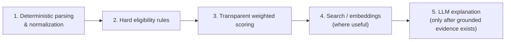

# Scoring and Matching Model

Status: **proposal** for the pipeline shape and sub-score list (both specified at a high level in
the project brief); exact weights and thresholds are explicitly **not decided** and should be
tuned against real postings during implementation, not guessed now.

## 1. Core principle: layered, explainable pipeline before any LLM

Per the project brief, the system must not rely entirely on a large language model for scoring or
ranking. The pipeline runs in this order, and no later stage may skip or override an earlier one:

1. **Deterministic parsing and normalization** — structured extraction of requirements from a
   posting (years of experience, degree level, named skills/tools, language, location, work
   authorization mentions) into the fields in [DATA_MODEL.md](DATA_MODEL.md).
2. **Hard eligibility rules** — binary pass/fail checks that don't get "scored," they gate. E.g.,
   "requires EU work authorization" against a profile that lacks it produces `eligibility_status =
   ineligible` regardless of how well skills otherwise match.
3. **Transparent weighted scoring** — the sub-scores below, each a simple, inspectable function of
   profile fields vs. requirement fields (see §3).
4. **Search or embeddings where useful** — e.g., matching a posting's free-text requirement ("
   experience with signal integrity analysis") against a user's project description using
   full-text search first, and pgvector similarity only if keyword matching proves insufficient
   (see [ADR-005](adr/ADR-005-explainable-ranking-before-llm-ranking.md)).
5. **LLM explanations only after grounded evidence exists** — an LLM may be used later to turn an
   already-computed, already-explainable score into readable prose ("you're a strong match because
   X, Y; you're missing Z"), never to invent the score itself, and never given the posting text as
   instructions.

## 2. Ranking 1 — Degree and market relevance (career opportunities)

Profile-independent. Inputs and rough shape (proposal):

| Sub-score | Computed from |
|---|---|
| `degree_relevance_score` | Overlap between posting's stated field/discipline and the ECE engineering-area list |
| `geographic_score` | Location within Germany, with a boost for Bremen/Hamburg, per stated preference weighting — never a hard filter |
| `language_score` | Whether the posting/workplace is English-friendly or requires German at a stated level |

Combined into `overall_market_score`. This ranking exists so the user can browse the market
honestly, including postings they don't yet qualify for — it must never be hidden behind or
conflated with Ranking 2.

## 3. Ranking 2 — Personal competitiveness (career opportunities)

Computed per user, per opportunity version. Sub-scores, each independently explainable:

| Sub-score | Computed from | Evidence surfaced |
|---|---|---|
| `eligibility_status` | Hard rules: work authorization, degree-level requirement, language requirement if mandatory | Which specific rule passed/failed and why |
| `degree_relevance_score` | Same basis as Ranking 1's, reused | — |
| `skill_alignment_score` | Overlap between posting's required/preferred skills and `user_skills`, weighted by proficiency | List of matched skills with proficiency, and list of required skills absent from the profile |
| `project_evidence_score` | Whether claimed skills are backed by linked `skill_evidence` rows (including project evidence), not just an assertion | Which evidence items support which claimed skills |
| `experience_alignment_score` | Years/type of experience in `work_experience` vs. posting's stated experience expectation | Matched or missing experience type |
| `language_alignment_score` | `user_languages` vs. posting's language requirement | — |
| `location_alignment_score` | `preferences.preferred_locations`/`bremen_hamburg_priority` vs. posting location, and remote acceptability | — |

`overall_category` is derived from the combination of the above (proposal, thresholds to be tuned
during implementation, not hardcoded arbitrarily today):

- **Ineligible** — any hard eligibility rule failed.
- **Currently unsuitable** — eligible, but skill/experience alignment is very low.
- **Reach** — eligible, partial alignment, meaningful gaps identified.
- **Realistic** — eligible, solid alignment, some gaps.
- **Strong target** — eligible, high alignment across skill/project/experience dimensions.

**Explicit constraint, restated from the project brief**: this is never presented as a
statistically calibrated probability of acceptance. The UI language is "alignment estimate" /
"recommendation category," and a visible note explains the basis is evidence comparison, not
historical outcome data — until the system has enough real, consented outcome data (actual
application results) and a documented calibration method, at which point this document must be
updated before any probability-style framing is introduced.

## 4. Development-opportunity ranking

A separate weighted score built directly from the dimensions in
[OPPORTUNITY_TAXONOMY.md](OPPORTUNITY_TAXONOMY.md#category-development-opportunities). Each
dimension that depends on source data quality (cost, distance, reputation) must degrade to an
explicit "unknown" contribution rather than a fabricated default value — a missing cost field
must never silently score as "free." `evidence_jsonb` records which dimensions were actually
available for a given opportunity, so the UI can show "not enough information to fully rank this
one" honestly.

## 5. Handling missing or ambiguous data

- A posting missing a required field for a sub-score contributes "unknown" to that sub-score, not
  a guessed value, and the overall category calculation accounts for how much was actually
  knowable.
- Free-text requirement lines that don't map cleanly to the skills catalog are surfaced to the
  user as "unmatched requirement text" rather than silently dropped, so nothing disappears from
  the explanation.

## 6. Scoring versioning and recomputation

Every score record carries `scoring_version`. When the scoring algorithm changes, existing score
rows are not mutated in place — either a new scoring run recomputes and appends new version-tagged
rows, or old rows remain readable with their original version tag alongside the new ones,
depending on what implementation-time storage cost analysis favors. Scores are recomputed after
every ingestion run that touches a given opportunity and after any profile edit that could affect
alignment (see [DATA_FLOW.md](DATA_FLOW.md#5-data-freshness-expectations-proposal)).

## 7. Scores are pinned to a specific opportunity version

Every score row — `career_market_scores`, `career_fit_scores`, `development_scores` — is keyed to
a specific `opportunity_version_id`, never to the opportunity as a whole (see
[DATA_MODEL.md](DATA_MODEL.md#scoring-domain-shared-source-data-but-scores-are-computed-per-user-where-applicable)
and [ADR-006](adr/ADR-006-posting-version-history.md)). This is a hard rule, not an
implementation detail:

- A score describes alignment against the exact snapshot it was computed from. If the source
  posting later changes (a new `opportunity_version` is captured), the existing score row is left
  untouched — it keeps describing the version it was actually computed against.
- Recomputing a score for the new version produces a **new, separate, timestamped score row**. It
  does not update or replace the old one in place.
- What the UI shows as "current fit" is simply the score row associated with
  `opportunities.current_version_id` — but a user looking at a saved opportunity always sees the
  score tied to `saved_opportunities.saved_opportunity_version_id`, which may be an older version
  if they haven't refreshed their view since the posting changed. The UI must make this
  explicit ("this score is for the version you saved on <date>; a newer version exists") rather
  than quietly showing a number the user never actually reacted to.
- **A fit or market score must never silently change value because the underlying posting
  changed.** Any visible change in a score is always attributable to a new, distinct row a user
  can trace back to a specific new version — never a mutation of a number already shown.

## 8. Explicit non-goal at MVP

No acceptance-probability model, no training of any predictive model on outcomes, and no use of an
LLM as the sole source of a score. These remain out of scope until there is real outcome data and
a documented, reviewable calibration methodology — see [MVP_SCOPE.md](MVP_SCOPE.md) and
[OPEN_QUESTIONS.md](OPEN_QUESTIONS.md).
